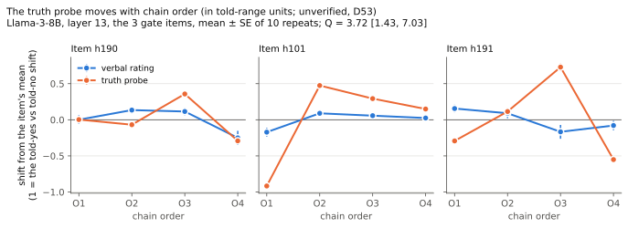

# Audit: probe-dissociation

**Files audited:** everything below exists only on the unmerged `probes` branch and was extracted read-only with `git show probes:<path>`: `experiments/probe-dissociation.md` (pre-registration), `experiments/probe_dissociation.py`, `experiments/probe_dissociation_explore.py`, `experiments/probe_dissociation_figure.py`, `experiments/local_lm.py`, `results/probe-dissociation.md`, `results/probe-dissociation.json`, `results/probe-dissociation-explore.json`, `results/probe-dissociation-llama3-8b-{gate,gate-summary,probes,run}.json`, `results/probe-dissociation-llama3-8b-theta.npz`, and `git diff main...probes -- DEVIATIONS.md`. For context I also read, on `audit`: `results/exp5-conversations.json` (Haiku comparison), `results/pool-run-3.json` and `experiments/split-exp5.json` (gold answers, claim leans), `paper/gold-map.md` §5, `README.md` and `paper/morning-brief.md`. My recomputation script is `scratchpad/g9/recompute.py`.
**Pre-registration:** `9ef909d` (2026-11-04 07:39:41), text in `experiments/probe-dissociation.md` §3–§5 plus `DEVIATIONS.md` "D48 — Gold map direction 5" (probes branch). The result is `8685008` (09:18:09). First call: git only. The run was local, so there are no request IDs and the archives have no timestamps.
Timing verdict: **not checkable beyond git order.** The pre-registration and frozen analysis code come before the result commit. Between freezing and the result, `probe_dissociation.py` changed only in `cmd_train`: a two-pass memory rewrite. I checked that it draws the same statement samples in the same RNG order and computes the same θ, so there is no design change. `local_lm.py` gained only memory settings and a counter. Nothing in the archive shows when the gate, training or step-3 runs happened. The claim of "no call on study items before freezing" rests on the authors' word.

## Plain-English summary of the audit
The arithmetic holds. Recomputed from the archived run, Q = 3.72 [1.48, 7.04] and r = +0.31 [−0.51, +0.99]. The gate passes with the same three items, and the told-yes/no positive control moves the probe the right way on all 10 items. The verdict label, PROBE MOVES, BUT NOT WITH THE RATING, is a row of the frozen rule, applied correctly.

Two problems sit underneath. First, step 3's verbal ratings are not new data. Every one of the 500 gate conversations was regenerated with the same seeds, so all 500 ratings and sub-ratings are identical. The claimed "replication" (V4) is therefore circular, and the gate items were selected on the very data used to test them. Second, "not with the rating" is an absence of evidence, not evidence of independence. With three gate items, r's interval just spans the three per-item correlations (+0.73, +1.00, −0.45), and its lower end is set by h191 alone. Holding the items fixed, r's interval is [+0.04, +0.57], which is positive.

"The probe moves more than the rating" is also a product of the told-range scaling, because the probe barely responds to testimony. In the probe's own true-versus-false units, order moves it about 6% of a gap. Measured against each measure's true-versus-false gap on these items, the probe moves less than the rating (Q ≈ 0.6–0.7). The plain-English sentences "the two move independently", "the orderings that raise the rating are not the ones that raise the probe" and "no stable belief underneath" should be cut or softened.

## Claims checked
| # | claim (quoted or paraphrased, with file:line) | recomputed / evidence | status |
|---|---|---|---|
| 1 | Gate: h190, h101, h191 show an order effect; 3 of 10, exactly the threshold (results/probe-dissociation.md:28-41) | spans 29.5/20.0/24.7; my p (own RNG) 0.0007/0.0007/0.0097 vs reported 0.0011/0.0004/0.0134; same G. h058 is borderline (0.055 vs 0.063). With Holm across the 10 items, h191 fails (0.013 > 0.00625) and the gate would be 2/10 → FAIL; the frozen gate was uncorrected | holds (minor) |
| 2 | Llama within-order SD median 13.0 (IQR 9.6–23.3) vs Haiku 2.9 (2.1–5.5) (:43) | 13.0 (9.6–23.3); Haiku from `exp5-conversations.json` anchor (a): 2.9 (2.1–5.5) | holds |
| 3 | "Llama's spans are as large as Haiku's or larger" (:43) | false on h112 (15.7 vs 51.0), h279 (12.8 vs 16.0) and h238 (6.5 vs 9.8). Llama's spans are also inflated by its noise: SE ≈ 4 per mean gives an expected noise-only span ≈ 8 points | overclaim |
| 4 | Llama "rates the main question 70–100 where Haiku gave 3–20 on the same items" (:43) | on the gate items, Llama's order means are 55–96 (h190 O4 = 55.0) and Haiku's are 2.8–19. Over all 10 items, Llama's run 40–100 and Haiku's 2.8–83 | holds (minor) |
| 5 | Probe: layer 13 selected, selection AUROC 0.90; report-set AUROC 0.88; dataset table (:47-55) | from probes.json: argmax of the selection mean = L13 at 0.903 (L14 and L15 both 0.900, a 0.003 margin); common_claim 0.881; table values match | holds |
| 6 | "The probe generalises well to statements it was not trained or selected on" (:57) | true for context-free held-out statements (0.88). It does not show the probe reads in-context belief: at L13, 80% of told-**no** readings still sit on the "true" side of the probe's midpoint | holds (minor) |
| 7 | D_V = 76.7 [60.8, 89.8]; D_P = 0.250 [0.191, 0.313]; V2 and V3 pass (:69-70) | 76.7 [60.2, 89.9]; 0.250 [0.188, 0.311]; D_P > 0 on 10/10 items, D_V > 0 on 10/10. The positive control passes, but weakly: D_P = 11.8% of the held-out true–false separation, and at adjacent layers it is ≈0 (L8 0.001, L9 0.013) or reversed (L10 −0.021) | holds (minor) |
| 8 | "p_V, verbal order effect on G (new data) 0.0001 — V4 passes: step 1's order effect replicates" (:71) | **all 500 O1–O4/B0 conversations in the run archive have M and sub-ratings identical to the gate archive.** The seed is `hash(model|qid|cell|rep)` in both steps, and the trimmed probe branch leaves no trace. This is the gate data replayed, not new data. p_V is computed on the items selected for low p in the same numbers | wrong |
| 9 | p_P = 0.0001 (:72) | 0.0001 (10,000 permutations, at the floor) | holds |
| 10 | Q = 3.72 [1.43, 7.03] (:73) | 3.72 [1.48, 7.04] (independent code, different RNG). LOO over gate items: 4.91 / 2.96 / 3.45 | holds |
| 11 | "the probe moves more than the rating" (:73; :13 bold; commit title; figure title) | true only in told-range units. Order SD: probe 0.127 = 0.060 of its held-out true–false gap, rating 10.5 pts = 0.105 of the scale. Scaling each by its B0 true-minus-false gap on these 10 items (probe 0.398, rating 23.7) gives Q ≈ 0.72; scaling by held-out separation against the 0–100 range gives ≈0.57. Q > 1 comes from the probe's tiny told response. Q also swings 1.87–9.39 across L13–L19 and is negative at L10 | overclaim |
| 12 | r = +0.31 [−0.49, +0.99]; "the direction is not tied to the rating" (:74) | +0.31 [−0.51, +0.99]. Per-item r: h190 +0.73, h101 +1.00, h191 −0.45. About 24% of item resamples contain only one distinct gate item, so the percentile CI ≈ [h191's r, h101's r]. Items fixed (repeats only): [+0.04, +0.57]. LOO: drop h101 → −0.02; drop h191 → +0.75. 22.7% of bootstrap r < 0. The CI is uninformative, and the point estimate is positive | overclaim |
| 13 | Verdict PROBE MOVES, BUT NOT WITH THE RATING is the frozen rule (:76) | row 4 of the §5 table in `9ef909d`, and `verdict()` is unchanged between `9ef909d` and `8685008`. Applied correctly (V1–V4 pass; p_P < 0.05; r lower bound ≤ 0). The label's wording turns "CI includes 0" into "not with" | holds (minor) |
| 14 | Noise floor: within-repeat SD 0.016–0.030 (1% of separation); between orders 0.07–0.16 (6%); told 12% (:79-81) | 0.016/0.023/0.030; 0.067/0.156/0.139; ratios 0.011, 0.060, 0.118 | holds |
| 15 | Sensitivity rows L11, L15, M-prompt, all-10 (:90-93) | L11 3.61 [2.29, 5.95], r +0.60 [+0.35, +0.81]; L15 2.92 [1.07, 5.75], +0.25; M-prompt 3.39, +0.15; all-10 4.79 [2.25, 6.67], +0.06 [−0.27, +0.38]; labels match | holds |
| 16 | "The all-ten-items row ... is the most precise, at r = +0.06" (:96) | narrowest CI, but 7 of its 10 items have no detectable verbal order effect, so their centred V means are mostly noise and r shrinks toward 0 by construction. It is a precise estimate of a different, diluted quantity | overclaim |
| 17 | Rating follows the last sub-claim's lean, +0.54 [+0.37, +0.74]; probe +0.14 [−0.23, +0.46]; probe vs rating (all 10) −0.16/+0.06 (:101-102) | +0.54, +0.14, +0.06 recomputed (CIs as archived). This is exploratory, on all 10 study items, after the verdict. r = 0.54 is 29% of variance (gate items only: 0.68) | holds as numbers; "mostly"/"does not" wording overclaims (see 18, 19) |
| 18 | "The rating does depend on order ... It mostly follows the last sub-claim asked" (:12) | the order effect holds on gate items, but the step-3 "replication" is the same data (row 8). "Mostly" against r = 0.54 (R² 0.29) is overstated | overclaim |
| 19 | "But the two move independently. The orderings that raise the rating are not the ones that raise the probe. The probe does not follow the last sub-claim either." (:14) | r = +0.31 point estimate; 2 of 3 gate items track strongly (+0.73, +1.00); items-fixed CI positive; +0.14 vs lean is an underpowered null | overclaim |
| 20 | "So the internal truth signal is not a stable belief ... Something in the context moves it, and the verbal answer does not track it." (:16) | first clause supported (p_P = 0.0001), though the movement is 6% of the probe's true–false gap. "Does not track it" is not shown (row 12) | overclaim |
| 21 | B0 AUROC 0.875 for both probe and rating (:106) | 0.875 / 0.875 (21/24 pairs, n = 10); hedged in the text | holds |
| 22 | "The two are dissociated in a different sense: they move for different reasons." / "The rating's order effect is mostly recency, and the probe does not share it." (:112-113) | not shown: no driver of the probe is identified (:104 says so), and r is not distinguishable from either 0 or 1 | overclaim |
| 23 | "Internally, there is no stable belief underneath that construction to fall back on either, at least none that a linear truth probe at layers 11–15 can find." (:114) | order moves the probe 6% of its true–false gap (rating ≈ 44% of its B0 gap). Layer 11 reads BELIEF MOVES (r CI [+0.35, +0.81]). It also ties Llama's internals to the "overnight picture" (NSIT and six formats are Haiku/Claude behaviour) | overclaim |
| 24 | "frozen in `9ef909d` before any call on the study items" (:3) | git order is consistent; no timestamps exist to verify | not checkable |
| 25 | "1,200 conversations" (:3) | 500 + 700 = 1,200 forward runs, but 500 of the 700 step-3 conversations reproduce the gate's ratings exactly (row 8). Distinct verbal data = 700 conversations | holds (minor) |

## Holes found
1. **Step 3's verbal data are the gate data replayed, so V4 and the "selection/test separation" are void.** I compared all 500 gate keys (10 items × O1–O4 + B0 × 10 repeats) with the run archive: 500/500 have identical M ratings and identical sub-rating sequences. The seed is `seed_for(f"{lm.name}|{key}")` with `key = f"{qid}|{cell}|{rep}"` in both `cmd_gate` and `cmd_run` (frozen code, `probe_dissociation.py:116-118`, `local_lm.py:109`). The pre-registration nonetheless says "Selection and test therefore use different conversations" (`experiments/probe-dissociation.md:44`), and the result calls p_V "new data" and a replication (`results/probe-dissociation.md:71`). Consequences:
   - V4 is guaranteed to pass for the items that passed the gate, so one of the four validity checks tested nothing.
   - The gate items were chosen for large order effects in exactly the numbers that enter Q's denominator, a winner's curse. This biases Q *downward*, so it does not inflate the headline.
   - The data do incidentally validate the cache-trimmed probe branch: it left the later ratings byte-identical.
2. **"Not with the rating" is decided by one item and an uninformative interval.** With |G| = 3 and items resampled from 10, about 24% of resamples contain one distinct gate item, so r's percentile CI is roughly the range of the per-item r's: h191 −0.45 to h101 +1.00. The reported [−0.49, +0.99] matches that. Resampling repeats only, r is [+0.04, +0.57]. Dropping h191 gives r = +0.75. The frozen row-4 label is applied correctly, but the rule could reach "BELIEF MOVES" with three items only if every item tracked. The result file then reads the label as a positive finding of independence (:14, :16, :74, :112, figure title).
3. **Q > 1 is a units artefact of a probe that hardly reads testimony.** Told "the answer is no", the L13 probe still reads the yes-statement on the "true" side 80% of the time, and D_P is 12% of its held-out true–false gap. At L8–L10, D_P is about 0 or negative. Dividing by this small D_P makes a 6%-of-gap order movement look 3.7× the rating's. Under the alternative scalings above, Q ≈ 0.6–0.7. Across L13–L19, Q runs 1.87–9.39. The verdict row does not use Q, but the headline sentences do ("moves more than the rating", commit title, figure title). The positive control passes (D_P CI > 0, 10/10 items), so the probe is not blind. It is weakly coupled to in-context evidence, and the authors' own :115 caveat ("reads stored knowledge more than in-context belief") is the more defensible reading.
4. **The gate passes only uncorrected.** Ten per-item permutation tests at α = 0.05 give an expected 0.5 false positives. Under Holm, h191 (p = 0.013) fails and the gate is 2/10, which is a FAIL. The frozen rule was uncorrected, so this is a caveat, not a breach. It matters more because, given hole 1, V4 cannot provide independent confirmation.
5. **Exploratory analysis.** `probe_dissociation_explore.py` reads `results/probe-dissociation.json`, so it ran after the analysis. It was first committed in the result commit and uses all 10 study items. It is correctly labelled exploratory. No layer, position or item choice was made after seeing step-3 data: layer 13 is the frozen argmax (0.903 against 0.900 at L14/L15), and the ±2 sensitivity layers, the M-prompt position and the all-10 row were all pre-registered. The explore results (r with lean +0.54 / +0.14) are nonetheless used in the plain-English answer (:12, :14) as if they were part of the finding.
6. **D-number collision.** The probes branch labels its pre-registration D48 (`9ef909d`, 07:39:41). Main's D48, "The No Credence paper's claims narrowed to what replicated on Sonnet and Opus" (`2ae4d19`, 09:18:13, `DEVIATIONS.md:866`), came 98 minutes later and 4 s after the probes result commit (09:18:09). Both append to the end of `DEVIATIONS.md`, so a merge will conflict and leave two D48s. One must be renumbered, along with the results file and the commit-message references.
7. **Main does not cite the result.** On `audit`/main there is no mention of `probe-dissociation`, `probe_dissociation` or direction 5's result in `README.md` or any `paper/*.md`. `paper/gold-map.md:269` still says direction 5 has "Nothing yet". `README.md:21` and `paper/morning-brief.md:4,31` count "six gold-map directions" and omit 5 without calling it pending. That is consistent with the result being unmerged, and nothing on main overclaims it. If it is merged, those three places need updating, with the scoping below.
8. **Generalisation.** The result is for one open 8B model, 4-bit quantised, one probe family, three gate items and one readout sentence per item. The Limits section scopes this properly (:119-122). The one sentence that bridges to Claude's behaviour is :114 (the "overnight picture" is Haiku's NSIT and six-format results), and it should not be read as a statement about Claude's internals. Nothing on main extends it to Claude.

## Overclaims to cut (exact sentences)
All paths are on the `probes` branch.
- `results/probe-dissociation.md:13` — "- **The probe moves too, and by more.** Measure each in units of how far it moves when the model is told "a reliable source says the answer is yes" versus "… no"." — "by more" holds only in told-range units, which the probe barely moves in. Scaled by true–false gaps, the probe moves less. — "- **The probe moves too.** In units of how far each moves when the model is told "a reliable source says the answer is yes" versus "… no", the probe's order effect is larger; but the probe barely responds to that cue, and in units of its own true-versus-false gap order moves it only about 6%."
- `results/probe-dissociation.md:14` — "- **But the two move independently.** The orderings that raise the rating are not the ones that raise the probe. The probe does not follow the last sub-claim either." — r = +0.31 [−0.49, +0.99]; 2 of 3 items track strongly; items-fixed CI [+0.04, +0.57]; +0.14 vs lean is an underpowered null. — "- **Whether the two move together is undetermined.** Their order means correlate at r = +0.31 [−0.49, +0.99] over three items (two track closely, one does not). There is no detectable link between the probe and the last sub-claim (+0.14 [−0.23, +0.46], exploratory)."
- `results/probe-dissociation.md:16` — "So the internal truth signal is not a stable belief under a constructed answer, and it is not a belief that the answer reports. Something in the context moves it, and the verbal answer does not track it." — the second sentence's last clause and "not a belief that the answer reports" are not shown. — "So the internal truth signal is not perfectly stable under chain order (it shifts by about 6% of its true-versus-false gap); whether the verbal answer tracks that shift could not be determined with three items."
- `results/probe-dissociation.md:12` — "It mostly follows the last sub-claim asked: if that claim leaned "yes", the rating goes up." — exploratory and post-verdict; r = 0.54 (R² 0.29). — "In an exploratory look, it partly follows the last sub-claim asked (r = +0.54): if that claim leaned "yes", the rating tends to go up."
- `results/probe-dissociation.md:20` — "" (the same text is the figure's suptitle in `experiments/probe_dissociation_figure.py:49`) — the same two overclaims. — ""
- `results/probe-dissociation.md:43` — "Llama's spans are as large as Haiku's or larger, but its between-repeat noise is much larger too" — false on h112, h279 and h238, and the spans are noise-inflated. — "Llama's spans are comparable to Haiku's on most items, but its between-repeat noise is much larger"
- `results/probe-dissociation.md:71` — "| p_V, verbal order effect on G (new data) | 0.0001 | V4 passes: step 1's order effect replicates |" — the 500 conversations are seed-identical to the gate, so this is not new data and not a replication. — "| p_V, verbal order effect on G (same seeds as step 1: the ratings are identical, so this is not an independent replication) | 0.0001 | V4 passes formally, but tests nothing beyond the gate |"
- `results/probe-dissociation.md:74` — "| **r**, correlation of order means (probe vs rating, 12 cells) | **+0.31 [−0.49, +0.99]** | the direction is not tied to the rating |" — the CI is uninformative. — "| **r**, correlation of order means (probe vs rating, 12 cells) | **+0.31 [−0.49, +0.99]** | undetermined: consistent with no tracking and with full tracking |"
- `results/probe-dissociation.md:96` — "The all-ten-items row, with 40 cells, is the most precise, at r = +0.06 [−0.25, +0.37]." — 7 of 10 items have no detectable rating order effect, which dilutes r toward 0. — "The all-ten-items row has the narrowest interval, r = +0.06 [−0.25, +0.37], but seven of its items show no detectable rating order effect, which pulls r toward 0."
- `results/probe-dissociation.md:112` — "  - The rating's order effect is mostly recency, and the probe does not share it." — "mostly" against R² 0.29, and "does not share" is an underpowered null. — "  - In an exploratory look, the rating's order effect partly follows recency (r = +0.54); no recency link was detected for the probe (+0.14 [−0.23, +0.46])."
- `results/probe-dissociation.md:113` — "  - The two are dissociated in a different sense: they move for different reasons." — not shown. — cut.
- `results/probe-dissociation.md:114` — "- **It fits the overnight picture, with a twist.** Behaviourally, the answer is largely constructed by the asking (NSIT, six formats). Internally, there is no stable belief underneath that construction to fall back on either, at least none that a linear truth probe at layers 11–15 can find." — the probe moves 6% of its true–false gap; layer 11 reads BELIEF MOVES; it bridges Haiku behaviour to Llama internals. — "- **On Llama-3-8B, the linear truth probe at layer 13 is not perfectly stable under chain order, but moves only about 6% of its true-versus-false gap.** Whether this bears on Claude, whose behavioural results (NSIT, six formats) motivated the test, is untested."
- `DEVIATIONS.md:726` (probes branch) — "- **Exploratory:** the rating follows the last sub-claim's lean (r = +0.54); the probe does not (+0.14)." — underpowered null stated as absence. — "- **Exploratory:** the rating partly follows the last sub-claim's lean (r = +0.54); no such link was detected for the probe (+0.14 [−0.23, +0.46])."
- `experiments/probe-dissociation.md:44` (pre-registration, frozen; flag only, do not edit) — "Selection and test therefore use different conversations." — false under the frozen seeding: the ratings are identical. Record this as a deviation in the D48 (to be renumbered) result note rather than editing the frozen text.
- Commit title `8685008` — "the truth probe moves with chain order more than the rating does (Q = 3.72 [1.43, 7.03]) but not in step with it" — cannot be edited. Any merge summary or README entry should not reuse this wording.

## Does the verdict stand?
The pre-registered verdict is PROBE MOVES, BUT NOT WITH THE RATING. **STANDS WITH CAVEATS.** As a mechanical application of the frozen rule to the archived numbers, it holds: V1–V3 pass on the data, p_P = 0.0001, and r's lower bound ≤ 0. "Probe moves" is real but small: about 6% of the probe's true–false gap.

"Not with the rating" means only "tracking not demonstrated". With three items, r's interval runs from the single opposing item (h191) to near-perfect tracking (h101). With items held fixed, it is positive. V4 passed only because step 3 replays the gate's seeds, so the frozen design's separation of selection from test was never achieved. Treated properly, the honest summary is: the probe shifts slightly with order; whether it moves with the rating is UNDETERMINED.

## Confidence
**Medium.** Every number checks out, but the run itself cannot be verified. From the archives I recomputed every number in the result: the gate, probe AUROCs, D_V, D_P, Q, r, both permutation p's, all sensitivity rows, the exploratory correlations, B0 AUROCs and the Haiku comparison. Everything matches to bootstrap or permutation noise. The seed-replay finding is exact (500/500 identical). I could not:
- rerun the model;
- check the probe on random directions as a control for "any context change moves any direction" (only θ-projections were archived, not hidden states);
- verify the timing of local runs (no IDs or timestamps);
- verify that no study item was run before freezing.

## Tally
claims_checked: 25
claims_failed: 10
overclaim_sentences: 15
verdict: STANDS WITH CAVEATS
confidence: medium
