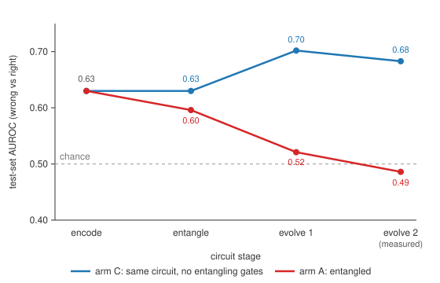
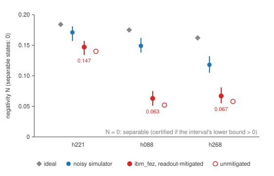

# Entangled Belief States Do Not Help a Language Model Judge: A Pre-Registered Negative Result

**Sean Pharris**
Independent Researcher, Colorado Springs, Colorado
November 4, 2026. Dates and times are local, America/Denver (MST, UTC−7).

Correspondence: seanm.pharris@gmail.com. Code, data and pre-registrations: https://github.com/GitPhar/entangled-mind. This paper condenses `paper/the-entangled-mind-v3.md`, which gives every table in full. Every number here is copied from a file in `results/`, and `experiments/reproduce.py` rebuilds every table from the archived data.

---

## Abstract

Quantum-cognition models describe human judgment with amplitudes, interference and entanglement rather than classical probabilities. We built such a model into a language model's judgment. For each question, `claude-haiku-5-5` answered and explained itself. The claims in its explanation were extracted and related to each other, and the resulting web was encoded as one entangled state on 5–16 qubits, evolved and measured.

**The main result is negative.** Pre-registered tests asked whether this state flags the model's wrong answers better than classical controls.
- **The fixed encoding** scored AUROC 0.55 [0.41, 0.67]. That is below the same circuit without entangling gates (0.68; difference +0.14 [−0.01, +0.29]) and a plain contradiction count (0.64; +0.10 [−0.07, +0.26]), and the data rule out the pre-registered +0.10 advantage over either.
- **A learned encoding** tied a classical twin with the same parameters and fitting rule, 0.83 against 0.84. The fit drove its couplings near zero.
- **An exploratory stage-by-stage readout** shows where the signal goes. It is present in the unentangled product state (0.63) and is destroyed by the entangling and coupled-evolution steps (0.49).
- **Sequential judgment.** A dynamic quantum belief state could not be told apart from a matched classical updater in predicting order-dependent ratings, and its parameter-free QQ signature is contradicted on the single scale direction: the verdict, first issued as a tie, is re-issued as classical (D52).

**Two results are positive.**
- **The hardware works.** On IBM's `ibm_fez`, a pre-registered witness certified that the encoded states are physically entangled, on 3 of 3 items chosen as the most entangled of 80 (pairwise; one pair decoupled).
- **Two classical signals carry the error information.** The model's own stated confidence predicted its errors better than every fixed structural reading of its explanation (0.82) and as well as the learned encodings (0.82–0.84 on the same items). And the learned quantum model's edges, on a second base model's errors and on Haiku's held-out set, came from a per-claim readout angle; a classical model given the same angle is not detectably behind it.

Entanglement is real on the hardware, and useless for this judgment.

---

## 1. Introduction

Quantum probability has been proposed as a better calculus than classical probability for human judgment. It accounts for order effects, conjunction fallacies and violations of the law of total probability (Busemeyer & Bruza, 2012; Pothos & Busemeyer, 2013). A language model that writes out competing considerations seemed a natural place to try it as an *architecture* rather than a description. One could hold the considerations as one entangled state, let them interact, and read out a judgment and a measure of internal conflict.

We pre-registered a simple version of that hope. If the entangled state captures conflict among the model's reasons, it should flag the answers the model gets wrong better than classical summaries of the same reasons. We then gave the quantum model every chance:
- a fixed encoding;
- a learned one;
- one with an "honest hedge";
- hardware execution;
- a second base model;
- a move to sequential judgment, where the human evidence for quantum cognition actually lies.

Every primary pre-registered comparison against a matched classical model was a tie or a loss, and no secondary edge was detectably larger than a classical model with the same readout achieves. This paper reports the result plainly, shows where the signal is lost (Figure 1), and records what the hardware did (Figure 2). It also states the two positive side results: the model's stated confidence, and a per-claim readout angle.

---

## 2. Method

### 2.1 Items and pipeline

- **Items.** The hard pool has 300 yes/no questions: 120 SimpleQA, 120 MMLU-Pro physics and chemistry, and 60 author-written claims. The base model `claude-haiku-5-5` answers 44 of them wrongly. Version two adds a separate 1,048-item training pool (158 wrong), split 60/20/20 into train, validation and a locked test set, which has 209 items, 32 of them wrong.
- **Pipeline.**
  1. The base model answers with a visible explanation of considerations for and against.
  2. `claude-sonnet-5-5` extracts 5–16 claims from that explanation, each as {text, confidence, lean}.
  3. `claude-haiku-5-5` labels every pair of claims as supports, contradicts or unrelated, with a strength.

  Claims come from the visible explanation, never from hidden thinking (D1–D3).

### 2.2 Encoding

- **Qubits and preparation.** One qubit per claim, prepared by RY(θ = confidence · π/2) and RZ(φ). The phases φ minimise an XY energy over the relation web, with phase 0 meaning "yes".
- **Entangling.** RZZ(κJ_ij) on every related pair.
- **Evolution and measurement.** Two Trotter steps of a problem Hamiltonian with a mixer, then measurement in the X basis.
- **Readout.** A confidence-weighted vote gives the judgment. The conflict score is the probability of strongly opposed camps.

### 2.3 Comparisons

All comparisons were pre-registered in `experiments/` before their data. Every change is logged in Appendix A.

- **Version one, fixed constants.** Arm A, the entangled circuit on a noisy simulator of `ibm_fez`, is compared with:
  - C, the same circuit with no two-qubit gates;
  - D, a shuffled relation web;
  - E, total contradiction strength;
  - A0, the noiseless circuit;
  - F, a classical Ising twin;
  - G, the model's self-reported confidence.

  The test set has 40 wrong and 40 right hard-pool items.
- **Version two, learned.** A2 (a learned quantum encoding) is compared with F2 (a classical heat-bath twin) and L (8 relation-web features). Each has 9 parameters and the same fitting rule. The pass criterion is that A2's lower 95% bound exceeds F2's upper bound on the locked test set.
- **Version 2.1.** Hedging claims are left out of the phase solve, and a learned hedge term is added to both A2.1 and F2.1.
- **Hardware.** A two-qubit tomography witness (negativity) runs on the most-entangled related pair of 3 items, on `ibm_fez`.
- **Sequential judgment (experiment 5).** The model rates 4 of its own claims and then the main question, on 0–100, in 12 chain types: orders, omissions, a midway choice and repeats. There are 40 items and 12,600 conversations.
  - **Models.** A5, a dynamic quantum belief state built from the encoder, against F5, a commuting-limit Markov/Bayes twin with the same 5 parameters.
  - **Pass rule.** Held-out prediction error, plus one of two parameter-free signatures: the QQ equality, or Kvam-style interference of a choice on later confidence.
- **Second base model.** Frozen v2 parameters are scored offline on `claude-sonnet-5-5`'s 298 hard-pool records. A pre-registered ablation then asks what any edge consists of.

---

## 3. Results

### 3.1 The fixed encoding fails, and the signal dies at the entangling step

On the 80-item test set (Table 1), every structural arm is beaten by the model's stated confidence, and the entangled arm is beaten by its own unentangled control.

**Table 1. Version one, test-set AUROC (40 wrong, 40 right).**

| arm | AUROC [95% CI] |
|---|---|
| A, entangled (noisy simulator) | 0.55 [0.41, 0.67] |
| A0, entangled (noiseless) | 0.49 [0.36, 0.62] |
| C, no entangling gates | 0.68 [0.57, 0.79] |
| D, shuffled relation web | 0.65 [0.52, 0.76] |
| E, contradiction strength | 0.64 [0.52, 0.75] |
| G, self-reported confidence | **0.82 [0.71, 0.90]** |

- **Noise is not the cause.** The noiseless circuit scores 0.49.
- **The relation web hurts.** The real web scores below 99% of 200 random webs with the same strengths (null mean 0.62).

**Where the signal goes (Figure 1; exploratory, not pre-registered).** The conflict score was read off the exact statevector at each stage of the circuit.
- The error signal is already in the unentangled product state, at 0.63.
- Without couplings, evolution sharpens it, to 0.70 and then 0.68.
- The entangling gates lower it to 0.60.
- The coupled evolution takes it to chance, 0.49.

Inspection of individual items shows two mechanisms:
- the entangling step creates opposed camps where the explanation has none;
- it cannot turn same-side inconsistency into opposition.

**Figure 1. The error signal is present before entanglement and destroyed by it.** Test-set AUROC of the exact conflict score, read at each circuit stage, on run 2's 40 wrong and 40 right items. Arm A (red) is the entangled circuit. Arm C (blue) is the same circuit with every two-qubit term removed, so its "entangle" stage equals "encode". The final points match the archived noiseless arm A0 (0.49) and noisy arm C (0.68). The model's stated confidence on the same items is 0.82, above the plotted range. Exploratory: computed after the pre-registered result was known (`paper/window-vignettes.md`, Table W1).

### 3.2 Learning the encoding: the fit switches entanglement off

**Table 2. Version two, locked test set (209 items, 32 wrong).**

| model | AUROC [95% CI] |
|---|---|
| A2, learned quantum encoding | 0.83 [0.75, 0.90] |
| F2, learned classical twin | 0.84 [0.78, 0.89] |
| L, relation-web features | 0.79 [0.70, 0.86] |
| G, self-reported confidence | 0.83 [0.78, 0.89] |

- **The primary criterion is not met.** The paired difference A2 − F2 is −0.007 [−0.079, +0.062].
- **A2's couplings fitted small.** The support and contradiction scales came out at 0.12 and 0.21, against 1 in version one, with a single Trotter step. Setting the couplings to 0 costs nothing detectable (−0.009 [−0.029, +0.009]), while v1-strength couplings lower train AUROC from 0.82 to 0.61.
- **Version 2.1 also ties:** A2.1 0.84 against F2.1 0.82. Both fits set the new hedge term's weight to 0, and the noisy simulator changes nothing detectable (+0.000 [−0.020, +0.023]).

### 3.3 The hardware: three selected states are certified entangled

**The witness.** It certified entanglement on 3 of 3 items (Figure 2), against a pre-registered rule of at least 2 of 3. The run used 39 circuits × 4,000 shots and 44 QPU seconds.

**The device washed the states out more than its noise model predicts.** Hardware negativity is 0.147, 0.063 and 0.067, against noisy-simulator values of 0.171, 0.149 and 0.118. The calibration logged at job time was ordinary for the device: median CZ error about 2 × 10⁻³, median T₁ 134–146 µs.

At 5–16 qubits every state is exactly simulable, so the hardware's role was certification, not speed.

**Figure 2. Three selected belief states are pairwise entangled on `ibm_fez`.** Negativity N of the two-qubit reduced state of each item's most-entangled related pair, with 95% intervals from 500 parametric bootstrap resamples. N = 0 for every separable state and 0.5 for a Bell pair. An item is certified if the lower bound of its readout-mitigated hardware interval exceeds 0. All three are certified, also without readout mitigation (open circles). Physical qubit pairs: h221 on 10 and 9; h088 on 44 and 37; h268 on 4 and 16. Job `dbl6e1d8mdtc73d5gesg` (`results/witness-run-1.md`).

### 3.4 Sequential judgment: real order effects, classical account

Graded ratings move with sequence. In experiment 3's yes/no design no order effect was detectable (the model gave the same answer in all 5 baseline runs for 85% of items), although experiment 4 run 1's yes/no audit showed order shifts in the first conjunct (OE_X up to +0.67). In experiment 5:
- **The order effects are large.** 60 of 80 claim–question pairs show an order effect above 0.10 (about 27 expected by chance; 40 survive a Holm-corrected permutation test), and the main-rating means span a median of 24.7 points across orders and omissions (13.2 from repeat noise alone).
- **The prediction contest ties.** The quantum belief state and its classical twin could not be told apart in predicting test-chain ratings: F5 − A5 = +67 [−34, +212] rating points².
- **The held-out edge is classical.** On 8 held-out items A5 does better (+207 [+52, +388]). But a dephased version, which is a classical Markov chain on the same states, is not detectably behind it (−11 [−61, +45]).
- **Neither parameter-free signature appears.**
  - The QQ statistic looked near zero only when two scale directions were pooled. On one scale it is −0.146 [−0.439, +0.137], with overdispersed per-pair values.
  - No effect of a midway choice on later confidence, beyond a filler turn, was detected: Δ_K = +0.29 [−1.12, +1.65].
- **The encoder had little to offer here.** It predicted non-commuting sub-questions for only 12 of 160 claims, so the pre-registration (§8.6) anticipated that A5 and F5 would be close.

### 3.5 A second base model, and what its edge was

**The frozen v2 models were scored on Sonnet's 298 hard-pool records,** with nothing refitted. A2 beat F2: 0.90 against 0.82, a paired +0.078 [+0.018, +0.137].

**A pre-registered ablation (Addendum D) found what the edge consists of.**
- Setting A2's couplings to exactly 0 changes nothing detectable: −0.006 [−0.029, +0.013].
- A classical twin given A2's per-claim tilted readout (F2+, Section 4.2) is level with A2: 0.90, a difference of +0.004 [−0.032, +0.042].
- The same holds for Haiku's earlier held-out edges (Addendum E): F2+ − A2 = −0.019 [−0.073, +0.029].

**No positive quantum-versus-classical difference in error prediction is significantly larger than what a classical model with the same per-claim readout achieves** (F2+ recovers 1.05 [0.73, 2.50] of the Sonnet edge and 0.68 [0.20, 1.21] of the held-out A2.1 edge).

---

## 4. Positive side results

### 4.1 Stated confidence is the best or tied-best error signal, and a good reading of the answer

**One call asking the model how confident it is does as well as every structural analysis of its reasoning**, quantum or classical (no paired difference with the best structural model excludes 0):
- 0.82 on run 2's test set and 0.83 on the locked test set for Haiku;
- 0.91 [0.86, 0.95] for Sonnet on its own hard-pool errors.

It is the best arm in every subgroup of the split analysis. The relation web adds nothing beyond it.

**A later pre-registered test** (`results/gm1-self-knowledge.md`) had each model rate both models' answers with one matched prompt.
- Authorship does not help. The judge × author interaction is −0.055 [−0.103, −0.007].
- Sonnet predicts Haiku's errors better than Haiku does: 0.93 against 0.85.

So authorship adds nothing detectable to a fresh-context confidence rating, and a judge that knows the answer does better. The practical lesson: a pipeline that wants an error flag should first ask for a confidence rating, from the author or from a stronger reader, and should require any structural method to beat that baseline. Ours did not.

### 4.2 A per-claim readout angle carries a real, classical signal

**Where the angle came from.** The learned quantum model's only useful ingredient was its tilted readout. Each claim's vote is read along an axis tilted by a learned angle α. For an uncoupled qubit, that gives

P(yes) = (1 + sin θ cos φ cos α + cos θ sin α)/2.

**What it does.** It mixes each claim's uncommitted component, cos θ, which is large when the claim's confidence is low, into its vote. It is a per-claim reweighting by confidence, with no superposition across claims and no entanglement.

**Its effect, when added to the classical twin F2 (making F2+):**
- +0.082 [+0.045, +0.120] on Sonnet's hard pool, the whole of A2's lead there;
- +0.088 [+0.014, +0.167] on Haiku's run-2 held-out set;
- +0.009 [−0.057, +0.065] on Haiku's locked test set, where A2 and F2 already tied.

**Reading.** It is a classical feature that the quantum parametrisation happened to find. Low-confidence claims carry error information that a vote weighted only by lean throws away.

---

## 5. Discussion

**Entanglement does not help here.** Four pre-registered comparisons on error prediction agree. In none of them does the entangled state add anything detectable over a matched classical model:
- the fixed encoding against its controls;
- the learned encoding against its twin;
- the honest-hedge encoding against its twin;
- every structural arm against the model's self-report.

The obvious explanations are ruled out:
- **Not noise:** the noiseless circuit is worse.
- **Not one bad choice of constants:** the learned fit was free to set the couplings, and setting them to 0 costs nothing detectable.
- **Not the hedge encoding:** removing that distortion changed nothing.
- **Not a frame bug in the phase solve:** correcting it changed the AUROCs by no detectable amount (A0 −0.015 [−0.054, +0.016]).

Figure 1 shows that the coupled steps destroy a signal the product state already has. When the fit was free to choose, it chose a nearly unentangled state.

**What this does and does not say.**
- It does not refute quantum cognition, which models human aggregates.
- It does show that an indecomposable entangled whole, certified on hardware (Figure 2), is not by itself an advantage for this kind of judgment.
- In sequential judgment, where quantum cognition's human evidence lies, the model shows the phenomena: large order effects, and single but not double conjunction fallacies (experiment 4, on Yearsley & Trueblood's, 2018, items and rules). In experiment 5, a classical Markov chain describes the order effects as well as the quantum state does; experiment 4's fallacies were not modelled.

**A methodological point.** Build the state per item from stated reasons, and compare it against a classical twin with the same inputs, parameter budget and fitting rule. This method can return "no", and here it did, repeatedly.

---

## 6. Limitations

- **One base model for the primary results.** Every pre-registered primary comparison uses `claude-haiku-5-5`. Sonnet contributes a secondary, offline transfer test, because its replication was halted by a second extractor refusal (D25).
- **Visible explanations, not deliberation.** Claims come from what the model writes for the reader.
- **Models judging models.** The extractor and relation judge are language models, and their errors bound what any arm can find.
- **Error types.** Most errors are ignorance and multi-step science, not the judgment errors quantum cognition studies.
- **Moderate test sets.** Run 2 has 80 items. The locked test set has 209, of which 32 are wrong. Many intervals overlap.
- **The analysis grew after the primary failure.** Each addition was pre-registered before its data, but designed knowing that run 2 had failed (Appendix A).
- **Exploratory components.** Figure 1 and the item-level mechanisms in Section 3.1 are exploratory.
- **Hardware scope.** One pair was witnessed in each of 3 items, and arm B (the full circuit on hardware) never ran, because its simulator gate was not met.

---

## 7. Reproduction

- **Tables.** `experiments/reproduce.py` rebuilds every results table from the archived JSON with the network blocked. Its output matches the committed tables byte for byte above their hand-written reading sections.
- **Hardware.** The as-run hardware circuits, exported from IBM's job records, are in `window/data/hardware/`. IBM's own circuit drawings are in `window/hardware/`. The calibration at job time is in `results/ibm-calibration.md`.
- **Visualiser.** The window (`window/`) shows every item stage by stage, including the states behind Figure 1.
- **Full record.** The long-form account is `paper/the-entangled-mind-v3.md`, and the chronological record is `paper/record.md`.

---

## References

- Busemeyer, J. R., & Bruza, P. D. (2012). *Quantum Models of Cognition and Decision*. Cambridge University Press.
- Kvam, P. D., Pleskac, T. J., Yu, S., & Busemeyer, J. R. (2015). Interference effects of choice on confidence. *PNAS, 112*(34), 10645–10650.
- Pothos, E. M., & Busemeyer, J. R. (2013). Can quantum probability provide a new direction for cognitive modeling? *Behavioral and Brain Sciences, 36*(3), 255–274.
- Wang, Z., & Busemeyer, J. R. (2013). A quantum question order model supported by empirical tests of an a priori and precise prediction. *Topics in Cognitive Science, 5*(4), 689–710.
- Yearsley, J. M., & Trueblood, J. S. (2018). A quantum theory account of order effects and conjunction fallacies in political judgments. *Psychonomic Bulletin & Review, 25*, 1517–1525.

The full reference list is in `paper/the-entangled-mind-v3.md` and `paper/references.bib`.

---

## Appendix A. Pre-registration and deviation log

The pre-registrations were committed before the data they govern. The files are:
- `experiments/preregistration.md`
- `preregistration-v2.md`
- `exp3-order-effects.md`
- `exp4-yearsley-trueblood.md`
- `exp5-sequential-judgment.md`
- the gold-map files `gm*.md`

`DEVIATIONS.md` records every change, with its date and reason. The table below summarises it.

| | what changed | why | effect on interpretation |
|---|---|---|---|
| **D1–D3** | Claims come from the model's *visible* explanation, not its hidden thinking. | The API's `reasoning_extraction` safeguard refused two designs. We redesigned rather than route around it. | Every result concerns the reasoning the model wrote down. |
| **D4–D6** | Computational extension; base model changed to `claude-haiku-5-5`; 300-item hard pool. | Sonnet made no errors, and Haiku few, on the standard pool. | Errors are mostly ignorance (SimpleQA) and multi-step science. |
| **D7** | Arms F and G, bootstrap intervals, the 200-shuffle null (Addendum A). | Added after run 2, before any F, G or null number existed. | Reported as run 2b. |
| **D8** | Witness readout calibration built on the measured physical qubits. | The transpiler could move calibration circuits elsewhere. | None. |
| **D9, D10** | 1,048-item training pool; QPU-seconds ledger fixed. | v2 needs separate training data; a parsing bug. | None. |
| **D11** | Experiment 4 pre-registered; R2 wording corrected before any call. | R2 is not unique to the quantum model. | R2 rules out only the static twin. |
| **D12** | Version two pre-registered; pass criterion read as non-overlapping intervals; fitting on exact noiseless scores. | Before any fitting. | The strongest version of the quantum model is tested. |
| **D13** | Experiment 3 implementation choices. | Logged before any result. | None. |
| **D14** | Hedge baseline H and the v2.1 honest hedge. | Prompted by an exploratory window observation (W4); added before any v2 test evaluation. | The run-2 held-out set is not independent of the suggestion; the locked test set is. |
| **D15** | The phase solver's frame drifts off axis; a stronger-anchor correction was characterised. | Found by inspecting the window. | Archived results keep the as-run solver; the fix changes the AUROCs by no detectable amount. |
| **D16** | v2.1 fitted noiseless, evaluated noiseless and on the noisy simulator. | Before any v2.1 fit. | The pass criterion uses the noiseless comparison. |
| **D17** | Experiment 4 run 2, graded, pre-registered; temperature cannot be set for this model. | Run 1's binary phase saturated. | Graded ratings at the default temperature of 1.0. |
| **D18** | Second base model (`claude-sonnet-5-5`) replication set up. | To test whether results depend on one base model. | — |
| **D19** | The pre-registered anchoring estimator in experiment 4 run 2 is near-tautological. | Logged after run 2's results. | The run's pre-registered verdict stands but does not show anchoring; the mechanism is undetermined. |
| **D20** | Sonnet replication stopped on a `reasoning_extraction` refusal of the extractor. | The project's rule: stop at once, reword nothing, retry nothing. | — |
| **D21** | Replication resumed with the refused item `h101` excluded; the extractor is unchanged, and a second refusal stops the run again. | Sean's decision after D20. | The Sonnet hard pool has 299 items. |
| **D22–D24** | Experiment 5 frozen; pilot items clarified (the 5-per-category cap left no further right items, so the next 2 in the uncapped ranking are used); split and runner committed; one pilot item's 4th chain slot filled. | Gaps in the draft's wording, found and fixed before any call. | None on the 40 scored items. |
| **D25** | Sonnet replication stopped on a second `reasoning_extraction` refusal (`t368`, training pool). The scorer was not run, because its arm-G step would make further Sonnet calls. | The project's rule and Sean's instruction. | Arm G cannot be scored on Sonnet. |
| **D26** | Experiment 5's model details left open by the frozen text, and the verdict's "contradicted" case, fixed in code. | Committed during full-run collection, before any fit or result. | — |
| **D27** | Sonnet's 298 hard-pool records scored offline (L, H, A2, F2) with frozen v2 parameters; every API client blocked in code; G not scored; the 82 training-pool records not scored. | Sean's request after D25. | A secondary transfer test, with nothing refitted. |
| **D28** | Addendum D, the coupling ablation A2(κ=0) and the classical twin F2+ with A2's per-claim readout, with its outcome rule fixed in advance; and arm G on Sonnet's hard pool. | To test what the Sonnet edge is. | Outcome 1: single-claim geometry, carried by a classical model (Section 5.11). |
| **D29** | Every date in the repository uses local America/Denver time. The frozen pre-registrations changed only in how the same instants are written. | Sean's instruction. | None. |
| **D30** | Addendum E: the frozen F2+ scored once on Haiku's run-2 held-out set. | To test whether Haiku's held-out edges are also readout geometry. | Outcome 1 (Section 5.11). |
| **D31** | Machine-written timestamps (IBM usage ledger, calibration, job-status log) switched to America/Denver; tables regenerated by their writers. | Sean's time-zone rule. | None; `reproduce.py` still matches byte for byte. |
| **D32** | Experiment 5's a priori QQ sub-test compared predicted non-commutativity with exact float inequality, so solver round-off ordered the pairs and gave a spurious 28–9. With a 10⁻⁶ tolerance it is 1–2 over 3 items. | Found after results. | The verdict does not use this sub-test and is unchanged. |
| **D33** | Experiment 4 run 3 frozen with one stated scale direction; experiment 5 single-scale re-run pre-registered. | Experiment 5's anchor-direction artefact. | Both run once (Sections 5.9 and 5.12). |
| **D34, D35** | Gold-map direction 9 (NSIT on archived experiment 5 data, anchor (a) only) and direction 3's free look (the scale-direction gap against errors) pre-registered, each in its own commit, before analysis. | Sean's overnight brief: six gold-map directions in order, one scale direction for every new design, stop on any refusal. | Section 5.13. |
| **D36** | Direction 1 pre-registered with a judge × author interaction as the primary statistic, matched framing in all four cells, and a recognition check for the paraphrase arm. | Changed from the gold map's sketch before freezing, after full-text reads (Xiao et al.; Panickssery et al.; Ashuach et al.). | Section 5.13. |
| **D36 amendments** | Direction 1's step order changed mid-run, before steps 3 and 4, when Sonnet calls cost more than assumed. A token-cap crash then lost up to $0.20 of calls; token-capped judge calls are recorded as no rating. | Budget. | The paraphrase arm covers 60 of 80 questions and Sonnet's recognition check did not run. The primary result is unaffected. Spend may have exceeded the $3 cap by up to $0.02. |
| **D37–D39** | Gold-map directions 2 (shown / redacted / planted transcripts), 3 (six formats) and 4 (evidence-seeking menus) pre-registered, each in its own commit, before any call. | The overnight brief. Changes from the gold map were made before freezing, after the full-text reads: plants ±15 rather than ±30 (Kumaran et al.); a 7-point verbal scale in place of the reversed scale; a most-uncertain baseline beside EIG. | Section 5.13. |

**On sequencing.** The analysis grew in stages, and each addition was committed before its data existed:
- Addendum A came after run 2.
- Version two came after run 2b.
- v2.1 came after an exploratory observation.
- Experiment 4's graded run came after run 1 saturated.
- The gold-map tests came after experiment 5.

Even so, every addition after run 2 was designed knowing that run 2 had failed.
