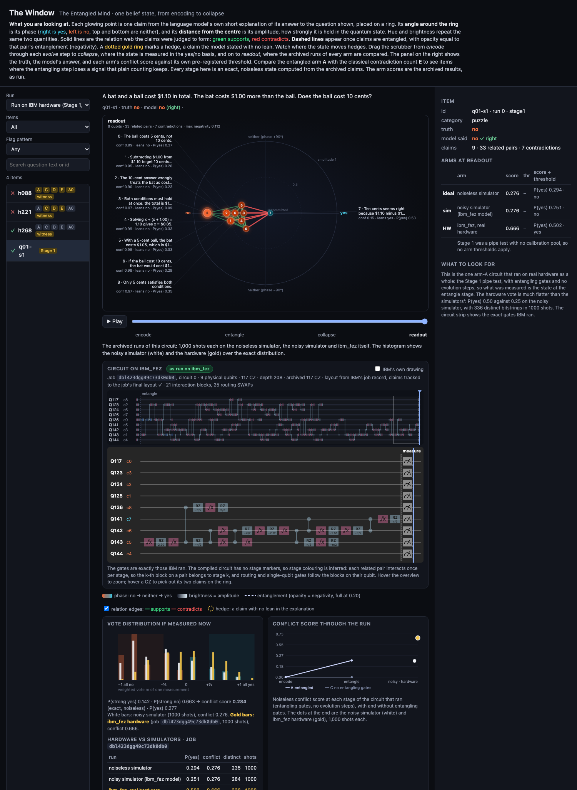

# The window

A visual display of one belief state at a time. Each of the model's claims sits on a ring at its qubit's equatorial Bloch vector: angle = phase (right yes, left no), distance from centre = amplitude, repeated by hue and brightness. Relation edges are green (supports) and red (contradicts), with a toggle; dashed links are entanglement, opacity = negativity; a dotted gold ring marks hedges (claims with no lean), kept at every stage. A scrubber runs from encode through each evolution step to collapse (points drop onto the yes/no axis at 2 P(yes) - 1) and readout, and points tween between stages so claims visibly rotate. The side panel compares every arm's archived conflict score against its own threshold.

Under the ring, a **circuit strip** shows the item's circuit for `ibm_fez` in the Qiskit dark style: one row per physical qubit, RZ, √X and X boxes, CZ as two dots joined by a bar, and measurements at the end. The overview shows the whole circuit, and hovering it moves a zoom lens. A playhead follows the scrubber: gates of the current stage are bright, earlier ones dimmed and later ones faint. Hovering a CZ outlines its two claims on the ring and says whether it is an interaction or a routing SWAP.

- **As run on ibm_fez** (badge, green): items that ran on hardware, namely the Stage 1 pipe test (`q01-s1`, pool run 1's extraction of q01, N = 0) and the three witness items (`h221`, `h088`, `h268`, XX setting). The gates are the exact ISA circuits from IBM's job records, with their physical layout, as exported by the main session (`experiments/export_hardware_circuits.py` on `main`) into `window/data/hardware/<job_id>-<index>.json`. They have no stage markers, so stages are inferred from which claim pair each CZ block serves. The CZ counts equal the archived ones (Stage 1: 117 CZ, depth 208; witness: 137, 162, 230). The **IBM's own drawing** toggle shows IBM's drawing of that circuit, `window/hardware/<job_id>-<index>.svg`.
- **Recompiled** (badge, amber, "N CZ here vs M as archived"): every other item. The arm-A circuit is transpiled here against the FakeFez snapshot with the project's settings (optimisation level 3, seed 1), with a barrier at the end of each stage so every gate's stage is exact. Without the barriers the recompile matches the archived CZ count on all 422 items. With them, the drawn circuit drifts by 12.5 CZ on average, and the badge shows the drift. Physical qubit numbers here are the snapshot's layout.
- **Claim tracking:** each two-qubit block is classified by its Weyl coordinates (b ≈ π/4 means it contains a SWAP), and claims are moved when a SWAP block closes. The export stops unless every measured qubit ends up holding the claim its classical bit names, and unless no interaction block acts on an unrelated pair. Both checks pass on all 426 circuits.

For hardware items the vote panel puts hardware counts beside the simulators': the Stage 1 hardware vote histogram (gold) next to the noisy simulator's (white), and for witness items the pair's joint yes/no outcomes (exact, arm A on the noisy simulator, hardware XX with 4,000 shots) with the tomographic negativity.

```bash
.venv/bin/python experiments/export_window.py   # regenerate window/data/ (about 3.5 minutes; simulation only, no API keys)
# as-run hardware circuits are read from window/data/hardware/ (written by experiments/export_hardware_circuits.py);
# --hardware-dir points the export at another copy
python3 -m http.server -d window 8000           # then open http://localhost:8000/
```

Deep links: `http://localhost:8000/?item=h135&stage=1` (stages 0-5: encode, entangle, evolve 1, evolve 2, collapse, readout; `q01-s1` has 0-3: encode, entangle, collapse, readout). The Run menu's last entry lists the items run on IBM hardware. Keys: left and right arrows step through the stages; space plays.

- **Stages** are exact, noiseless statevectors rebuilt from the archived claims with `src/entangled_mind` (read-only). The staged evolution is checked against the full circuit, and the final conflict score against archived arm A0 (mean absolute difference 0.016 over 425 items, which is sampling noise for 1,000 shots).
- **Arm scores and flags** are the archived results in `results/stage2-run-{1,2}.json`. The export reproduces every arm's published flag counts.
- **The per-stage AUROC line** in the trajectory card is exploratory, not pre-registered.


